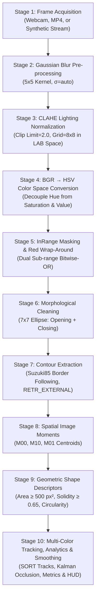

# Color-Based Object Detection and Real-Time Tracking System

> **Production-Ready, Modular Computer Vision Pipeline for Real-Time Multi-Color Detection, Persistent Tracking, Analytics & Interactive Vision Applications**

A production-ready, modular Python computer vision system combining the HSV colour space, CLAHE lighting normalization, Gray World color constancy, morphological filtering, spatial moments, linear Kalman filters, and exponential moving average (EMA) temporal smoothing. The system features a modern CustomTkinter/Tkinter desktop GUI, ultra-clean single-target and multi-object tracking, directional tripwire counting, monitored ROI zone dwell analytics, telemetry kinematics logging, video recording, and an automated unit-test suite.

---

## Table of Contents

1. [Features](#features)
2. [Project Structure](#project-structure)
3. [Prerequisites & Installation](#prerequisites--installation)
4. [Step-by-Step: How to Run](#step-by-step-how-to-run)
   - [Quick Command Table](#quick-command-table)
   - [Step 1 — Launch Desktop GUI App](#step-1--launch-desktop-gui-app-recommended)
   - [Step 2 — Clean Target Tracking & Color Calibration](#step-2--clean-target-tracking--color-calibration)
   - [Step 3 — Computer Vision Analytics & Tripwires](#step-3--computer-vision-analytics--tripwires)
   - [Step 4 — Multi-Object Tracking, Occlusion Recovery & Pinhole Distance](#step-4--multi-object-tracking-occlusion-recovery--pinhole-distance)
   - [Step 5 — Generate Synthetic MP4 Benchmark Video](#step-5--generate-synthetic-mp4-benchmark-video)
   - [Step 6 — Run Live Tracking via CLI (OpenCV Window)](#step-6--run-live-tracking-via-cli-opencv-window)
   - [Step 7 — Run 10-Stage Pipeline Walkthrough & Visual Demo](#step-7--run-10-stage-pipeline-walkthrough--visual-demo)
   - [Step 8 — Run Automated Unit Tests](#step-8--run-automated-unit-tests)
   - [Step 9 — Run Benchmark Suite & Generate Analytical Plots](#step-9--run-benchmark-suite--generate-analytical-plots)
5. [Quick Start (Python API)](#quick-start-python-api)
6. [GUI Controls & Dual-Canvas Interface](#gui-controls--dual-canvas-interface)
7. [The 10-Stage Computer Vision Pipeline](#the-10-stage-computer-vision-pipeline)
8. [Running the Benchmark Suite](#running-the-benchmark-suite)
9. [Running the Automated Unit Tests](#running-the-automated-unit-tests)
10. [Configuration Reference](#configuration-reference)
11. [Troubleshooting & FAQs](#troubleshooting--faqs)
12. [License](#license)

---

## Features

| Feature | Details |
|---------|---------|
| **Multi-Object Persistent ID Tracking** | Euclidean distance and spatial cost matching assigns stable IDs (`ID #1`, `ID #2`) across frames for multiple targets. |
| **Kalman Occlusion Handling** | When an object is obscured, a 4-state linear Kalman Filter projects its trajectory forward without visual clutter. |
| **Pinhole Metric Distance & Speed** | Estimates physical distance ($Z = \frac{f \cdot W_{real}}{w_{px}}$) in centimeters ($cm$) and metric velocity in $m/s$. |
| **Directional Virtual Tripwires** | Directional vector-crossing detection counts objects moving `IN` and `OUT` across customizable lines with flash animations. |
| **Monitored ROI Zone & Dwell Time** | Tracks real-time occupant counts and calculates exact dwell times (seconds) for objects inside defined regions. |
| **Telemetry Kinematics Logger** | Exports frame-by-frame kinematics (`timestamp, track_id, x, y, speed, distance_cm, metric_speed_mps`) to CSV and JSON. |
| **Live Session Video Recording** | Built-in `cv2.VideoWriter` recording engine with multi-codec fallback (`mp4v`, `avc1`, `XVID`) and on-screen `● REC` indicator. |
| **Gray World Color Constancy** | Normalizes ambient illumination casts (warm tungsten, cool fluorescent) to prevent false color shifts before thresholding. |
| **Live Webcam & Video File Input** | Robust `cv2.VideoCapture` handling with device indexing, video file loading, and seamless looping (`cv2.CAP_PROP_POS_FRAMES = 0`). |
| **Synthetic Fallback & Headless Mode** | If no physical webcam is detected, automatically switches to an animated synthetic geometric test stream out-of-the-box. |
| **MP4 Benchmark Video Generator** | Synthesizes realistic 60 FPS test videos featuring 3D specular spheres, glossy bevels, ambient lux shifts, shadows, and sensor noise. |
| **Adaptive CLAHE Equalization** | Contrast-Limited Adaptive Histogram Equalization in LAB space protects chromatic segmentation against shadows and severe glare. |
| **Gaussian & Bilateral Pre-processing** | $5 \times 5$ Gaussian kernel attenuates photon shot noise while preserving boundary edges. |
| **Decoupled HSV Color Space** | Isolates wavelength (Hue) from vibrancy (Saturation) and illuminance (Value) to eliminate lighting drift. |
| **9 Color Presets + Multi-Color** | Calibrated bounds for **Red**, **Orange**, **Yellow**, **Green**, **Cyan**, **Blue**, **Purple**, **Pink**, and **White**, plus multi-color tracking. |
| **Red Hue Wrap-Around Union** | Dual sub-range masking ($[0..10]$ and $[165..180]$) prevents partial detection loss at the $0^\circ / 360^\circ$ circular hue boundary. |
| **Morphological Cleaning** | Two-stage Elliptical ($7 \times 7$) Opening (removes background speckles) and Closing (fills interior specular reflections). |
| **Spatial Moment Centroids** | First-order image moments ($\bar{x} = M_{10}/M_{00}$, $\bar{y} = M_{01}/M_{00}$) determine true physical center of mass. |
| **Shape Descriptors & Rejection** | Filters candidates by minimum contour area ($\ge 500\,\text{px}^2$), minimum solidity ($\ge 0.65$), and computes circularity metrics. |
| **Temporal EMA Centroid Smoothing** | Exponential Moving Average ($\alpha = 0.7$) eliminates jitter and renders smooth 32-frame trajectory motion trails. |
| **Desktop GUI with Eyedropper** | Dual canvases (Annotated BGR + Binary Mask), click-to-pick eyedropper calibration, real-time HSV sliders, and snapshot export. |
| **Educational 10-Stage Walkthrough** | Terminal math explanations and 8-panel intermediate transformation graphic (`pipeline_demonstration.png`). |
| **Comprehensive Test Suite** | 229 automated pytest tests covering all pipeline stages, boundary math, edge cases, analytics, and video streaming. |


---

## Project Structure

```
color-based-object-detection/
├── run.py                          ← Unified CLI launcher (GUI, CLI, demo, tests, benchmarks, video generation)
├── README.md                       ← Master documentation
├── requirements.txt                ← Core project dependencies
├── pyrightconfig.json              ← Language server & static type check configuration
├── pytest.ini                      ← Automated test discovery configuration
├── LICENSE                         ← MIT License
├── .env.example                    ← Optional environment variable template
│
├── assets/                         ← Media and test video assets
│   └── color_test_benchmark.mp4    ← Pre-generated 60 FPS multi-target synthetic benchmark video
│
├── benchmark_results/              ← Saved quantitative plots & visual artifacts
│   ├── benchmark_curves.png        ← End-to-end FPS vs. resolution + F1/IoU vs. ambient lux
│   ├── confusion_matrix.png        ← Per-class Precision, Recall, and F1 heatmap across all 9 colors
│   ├── pipeline_demonstration.png  ← 8-panel visual walkthrough across all 10 CV pipeline stages
│   └── pipeline_stages.png         ← Grouped bar chart of per-stage execution latency (microseconds)
│
├── benchmarks/
│   └── generate_video.py           ← Root forwarder script for MP4 benchmark generation
│
└── color_object_detection/         ← Core Python package
    ├── setup.py                    ← Pip install / setuptools configuration
    ├── README.md                   ← Package documentation mirror
    ├── requirements.txt            ← Package dependencies
    ├── pytest.ini                  ← Package-level test config
    │
    ├── src/                        ← Implementation modules
    │   ├── __init__.py
    │   ├── config.py               ← Central store: HSV bounds, pinhole optics, defaults
    │   ├── tracker.py              ← Core CV pipeline & orchestrator for analytics/apps
    │   ├── multitracker.py         ← MultiObjectTracker with Kalman filter & occlusion recovery
    │   ├── analytics.py            ← Tripwire, ROIZone, TelemetryLogger, VideoRecorder
    │   ├── utils.py                ← Pinhole distance/speed, Gray World, FPSCounter, StageTimer, HUD
    │   ├── gui_app.py              ← Dual-canvas GUI with Eyedropper, sliders, analytics toggles & app launchers
    │   └── pipeline_demo.py        ← Educational 10-stage walkthrough and composite graphic generator
    │
    ├── benchmarks/                 ← Performance evaluation harness
    │   ├── __init__.py
    │   ├── synthetic_data.py       ← Ground-truth synthetic frame generator with dynamic lighting
    │   ├── evaluate.py             ← Benchmark suite evaluating throughput, latency, and accuracy
    │   └── generate_video.py       ← Automated 60 FPS MP4 benchmark video generator
    │
    ├── tests/                      ← Automated pytest suite (229 tests)
    │   ├── __init__.py
    │   ├── test_bounds.py          ← HSV range validation, canonical pixel tests, non-overlap verification
    │   ├── test_tracker.py         ← Unit tests for CLAHE, EMA, morphology, contours, centroids, and looping
    │   └── test_new_features.py    ← Multi-tracker, pinhole optics, Gray World, tripwires, ROI zones, canvas, game
    │
    └── snapshots/                  ← Target directory for user-captured timestamped frames
```

---

## Prerequisites & Installation

### System Requirements
- **Python**: Version **3.9 or newer** (tested on 3.9, 3.10, 3.11, 3.12).
- **Webcam**: Built-in or external USB webcam (optional; synthetic streams and benchmark videos run fully without a camera).
- **Operating System**: Windows 10/11, macOS, or Linux.

### Step 1 — Clone the Repository
```bash
git clone https://github.com/Soham51826/color-based-object-detection.git
cd color-based-object-detection
```

### Step 2 — Create and Activate a Virtual Environment (Recommended)
```bash
# Windows (PowerShell)
python -m venv .venv
.venv\Scripts\Activate.ps1

# Windows (Command Prompt)
python -m venv .venv
.venv\Scripts\activate.bat

# Linux / macOS
python -m venv .venv
source .venv/bin/activate
```

### Step 3 — Install Dependencies
```bash
pip install -r requirements.txt
```

*(Optional) Install in editable development mode:*
```bash
pip install -e color_object_detection
```

---

## Step-by-Step: How to Run

### Quick Command Table

All operations can be executed directly from the repository root via the unified `run.py` entry point:

| Goal | Command | Description |
|------|---------|-------------|
| **Launch Desktop GUI** | `python run.py` | Full interactive dark-theme GUI with dual canvases, live sliders, eyedropper & analytics controls |
| **GUI (Load Benchmark Video)** | `python run.py --source assets/color_test_benchmark.mp4` | Launch GUI directly looping the 60 FPS multi-target benchmark video |
| **GUI (Specific Camera)** | `python run.py --source 1` | Open external webcam index 1 |
| **🚧 Directional Tripwire** | `python run.py --tripwire` | Directional vector line counter tracking `IN` and `OUT` crossing events with flash animations |
| **📍 Monitored ROI Zone** | `python run.py --roi-zone` | Defines a monitored bounding box region and calculates real-time occupancy and dwell time (seconds) |
| **🔴 Record Live MP4 Video** | `python run.py --record` | Records annotated session video directly to timestamped MP4 files in `snapshots/` |
| **📊 Log Kinematics Telemetry** | `python run.py --log-telemetry` | Buffers and exports frame-by-frame kinematics (`x, y, speed, distance_cm, metric_speed_mps`) to CSV |
| **💡 Gray World Constancy** | `python run.py --color-constancy` | Normalizes illuminant color casts (warm tungsten / cool blue fluorescent) before thresholding |
| **Generate Benchmark Video** | `python run.py --generate-video` | Synthesize 60 FPS MP4 benchmark video with specular highlights & glare |
| **Live Tracking (CLI)** | `python run.py --cli` | Fast, lightweight OpenCV window with tracking overlays (press `q` or `Esc` to quit) |
| **Track Specific Colors** | `python run.py --cli --colors Red Blue` | Track only selected color classes |
| **10-Stage Pipeline Demo** | `python run.py --demo` | Educational step-by-step walkthrough of all CV transformations + saves comparison graphic |
| **Run Unit Tests** | `python run.py --test` | Runs all 229 unit tests with verbose reporting (~4 seconds) |
| **Run Benchmark Suite** | `python run.py --benchmark` | Evaluates throughput (FPS) & accuracy across lux levels; generates 4 plots |

> 💡 **No Webcam? No Problem!**  
> If no physical camera is detected, the system **automatically falls back to a realistic synthetic test stream** with animated colored geometric targets. Everything works out-of-the-box!

---

### Step 1 — Launch Desktop GUI App (Recommended)

The full-featured graphical application provides real-time dual-canvas visualization, calibration sliders, video source switching, analytics toggles, and interactive application launch buttons:

```bash
# Launch with default webcam (auto-starts feed; falls back to synthetic feed if no camera)
python run.py

# Launch directly with the pre-generated benchmark video in continuous looping mode
python run.py --source assets/color_test_benchmark.mp4

# Launch with a specific external webcam index (e.g. index 1)
python run.py --source 1
```

**Key GUI Features**:
- **Dual Canvas Visualization**: Left panel displays raw BGR feed with tracked bounding boxes, persistent IDs, metric distances, speed, and trajectory trails; right panel shows the real-time binary segmentation mask.
- **Click-to-Pick Eyedropper**: Click any point on the camera canvas to sample local HSV values and auto-configure the calibration sliders.
- **Interactive Source Switching**: Toggle instantly between physical webcam input (`📹 Live Webcam`) and file input (`📂 Load Video (.mp4)`).
- **Video Looping Engine**: Automatically rewinds video files to frame 0 upon reaching the end, providing an uninterrupted stream for tuning.
- **Dynamic Feature Toggles**:
  - `Enable Multi-Object Tracking (IDs)`: Tracks multiple persistent targets across frames. When disabled (default), clean single-target mode tracks only the primary object without duplicate boxes.
  - `Estimate Metric Distance & Speed`: Calculates real-world distance ($Z$ in $cm$) and velocity in $m/s$ via pinhole camera optics.
  - `Gray World Color Constancy`: Automatically balances illumination temperature.
  - `Directional Virtual Tripwire`: Renders a line counter tracking objects crossing left-to-right (`IN`) vs right-to-left (`OUT`).
  - `Monitored ROI Zone & Dwell Time`: Renders a monitored spatial zone displaying current occupant count and dwell duration.
  - `Enable CLAHE Lighting Stabilization`: Neutralizes room lighting shifts and shadows.
  - `Enable Kalman/EMA Centroid Smoothing`: Eliminates centroid jitter.
  - `Show Motion Trajectory Trail`: Renders a clean 32-frame trailing path.
  - `Use Rotated Bounding Box`: Captures object orientation.
- **Application Action Buttons**:
  - `🔴 Record Video`: Toggles live MP4 video recording on and off.
  - `📊 Log Telemetry`: Buffers and dumps frame-by-frame kinematics to CSV.
  - `📸 Snapshot`: Saves timestamped annotated image to `snapshots/`.

---

### Step 2 — Clean Target Tracking & Color Calibration

The system is configured out-of-the-box for crystal-clear, focused tracking:

```bash
# Launch GUI (defaults to single-target tracking of Red)
python run.py

# Or launch CLI mode tracking only specific colors:
python run.py --cli --colors Red
```

**Key Tracking Principles**:
1. **Focused Color Selection**: By default, the system tracks only the active color chosen in the dropdown (e.g. `Red`). Switching to `Blue` or `Green` instantly recalibrates the sliders and filters out background clutter. Choose `Multi-Color` only when you want all colors detected simultaneously.
2. **Single-Target Priority**: In standard mode, only the primary detected object is bounded and highlighted with a clean `Color (cx, cy) | Spd px/s` badge. No ghost boxes or duplicate labels appear.
3. **Multi-Object Tracking (IDs)**: When enabled via the checkbox, stable numerical IDs (`ID #1 Red | 75cm`) are assigned to distinct objects. Occluded or lost tracks are immediately filtered out to keep the view clean.
4. **Click-to-Pick Eyedropper**: Click any point on the camera canvas to instantly sample its HSV values and auto-tune the sliders to match your exact lighting environment.

---

### Step 3 — Computer Vision Analytics & Tripwires

Deploy real-time spatial intelligence and telemetry analytics:

```bash
# Directional tripwire line counter (In / Out)
python run.py --tripwire

# Monitored ROI zone with dwell time analytics
python run.py --roi-zone

# 2D Motion Trajectory Heatmap
python run.py --heatmap

# Live Video Session Recording to MP4
python run.py --record

# Frame-by-Frame Kinematics Telemetry Logging to CSV
python run.py --log-telemetry

# Combine all analytics simultaneously:
python run.py --tripwire --roi-zone --heatmap --log-telemetry --record
```

- **Directional Tripwire**: Computes cross products of centroid displacement vectors against a virtual line segment. Objects crossing from side A to B increment the `IN` counter; B to A increments `OUT`. Flashes a neon trigger banner when crossing occurs.
- **Monitored ROI Zone**: Tracks real-time occupant counts inside a rectangular zone and calculates dwell time (in seconds) for each persistent object.
- **2D Trajectory Heatmap**: Accumulates Gaussian density kernels ($\sigma = 16\,\text{px}$) onto a floating-point density matrix with temporal decay ($\gamma = 0.998$). Colorizes the density with `cv2.COLORMAP_JET` and seamlessly alpha-blends it ($35\%$) over the video feed.
- **Kinematics Telemetry Logger**: Writes timestamped frame records (`timestamp`, `track_id`, `color`, `x`, `y`, `speed_px`, `distance_cm`, `metric_speed_mps`, `area`, `solidity`) to `snapshots/telemetry_YYYYMMDD_HHMMSS.csv`.

---

### Step 4 — Multi-Object Tracking, Occlusion Recovery & Pinhole Distance

```bash
# Enable Gray World color constancy and pinhole distance metrics
python run.py --color-constancy
```

- **Multi-Object Association**: Calculates pairwise Euclidean cost matrices between existing Kalman track positions and newly detected contour centroids, assigning persistent track IDs (`ID #1`, `ID #2`, etc.).
- **Occlusion Recovery**: When an object is momentarily blocked or occluded, its 4-state linear Kalman filter predicts its forward position $[x, y, v_x, v_y]^T$, rendering a dashed projection vector and predictive uncertainty cone until visual re-acquisition.
- **Pinhole Metric Optics**:
  $$\text{Distance } Z = \frac{f \cdot W_{\text{real}}}{w_{\text{px}}}$$
  Where $f = 800\,\text{px}$ is the calibrated focal length and $W_{\text{real}} = 6.0\,\text{cm}$ is the known object width.
  $$\text{Metric Velocity } v = \frac{\text{speed}_{\text{px/s}} \cdot Z}{f \cdot 100} \quad (\text{in } \text{m/s})$$
- **Adaptive Gray World Color Constancy**:
  $$\alpha_c = \frac{\mu_{\text{gray}}}{\mu_c}, \quad I'_c = \text{clip}(I_c \cdot \alpha_c, 0, 255)$$
  Eliminates ambient color temperature cast (e.g. warm incandescent bulb or cool fluorescent tube) prior to HSV conversion.

---

### Step 5 — Generate Synthetic MP4 Benchmark Video

Generate a standalone 60 FPS MP4 video containing moving colored targets, specular highlights, and room lighting shifts:

```bash
# Generate the default 10-second 60 FPS benchmark video
python run.py --generate-video

# Alternatively run the benchmark generator directly with custom duration/fps
python benchmarks/generate_video.py --duration 10.0 --fps 60 --out assets/color_test_benchmark.mp4
```

**Target Features Synthesized**:
- Spherical and rectangular bouncing targets for all supported palette colors: **Red**, **Orange**, **Yellow**, **Green**, **Cyan**, **Blue**, **Purple**, and **Pink**.
- Realistic 3D radial specular highlights on spheres and glossy bevel highlights on rectangles.
- Dynamic lighting variation simulating real-world environment changes: sinusoidal ambient lux shifts, sweeping room shadows, and specular lens glare patches.
- Mild Gaussian sensor noise (photon shot noise) simulating real CMOS webcam sensors.

---

### Step 6 — Run Live Tracking via CLI (OpenCV Window)

If you prefer a lightweight OpenCV window without the GUI interface:

```bash
# Track all 9 colours (default webcam or synthetic fallback)
python run.py --cli

# Specific camera index
python run.py --cli --source 1

# Specific colours only (e.g., Red and Blue)
python run.py --cli --colors Red Blue

# Video file
python run.py --cli --source assets/color_test_benchmark.mp4
```

> **Controls**: Press <kbd>q</kbd> or <kbd>Esc</kbd> while focused on the OpenCV window to exit.

---

### Step 7 — Run 10-Stage Pipeline Walkthrough & Visual Demo

To understand how each computer vision transformation operates mathematically under the hood:

```bash
python run.py --demo
```

**What happens**:
1. Processes an image through each of the 10 stages: Frame Acquisition, Gaussian Blur, CLAHE Equalization, BGR→HSV conversion, InRange Red Wrap-Around, Morphological Opening & Closing, Contour Detection, Spatial Moments ($M_{00}, M_{10}, M_{01}$), Geometric Solidity & Circularity Filtering, and EMA Trajectory Smoothing.
2. Prints an in-depth mathematical walkthrough in your terminal.
3. Generates and saves an 8-panel comparison graphic to [`benchmark_results/pipeline_demonstration.png`](benchmark_results/pipeline_demonstration.png).

---

### Step 8 — Run Automated Unit Tests

Run the automated test suite covering all pipeline components, video looping, HSV boundary math, red wrap-around union, centroid calculations, multi-tracking, pinhole depth, Gray World, tripwires, ROI zones, and telemetry:

```bash
# Run all unit tests via run.py
python run.py --test

# Alternatively, run via pytest directly
pytest color_object_detection/tests -v
```

---

### Step 9 — Run Benchmark Suite & Generate Analytical Plots

Run the quantitative benchmark harness to evaluate detection accuracy (Precision, Recall, F1, IoU) and latency across resolutions (QVGA to 1080p):

```bash
# Run full benchmark suite
python run.py --benchmark

# Custom output directory
python run.py --benchmark --out ./benchmark_results/

# High-precision benchmark (more frames, higher statistical power)
python run.py --benchmark --frames 500
```

**Generated Plots** (saved in `benchmark_results/`):
- `pipeline_demonstration.png`: 8-panel visual walkthrough across all stages.
- `benchmark_curves.png`: End-to-end FPS vs. resolution + F1-score/IoU vs. ambient lux.
- `confusion_matrix.png`: Per-class Precision, Recall, and F1 performance heatmap across all 9 colors.
- `pipeline_stages.png`: Detailed microsecond latency breakdown per pipeline stage.

---

## Quick Start (Python API)

You can import and use the pipeline directly in your own Python scripts:

```python
import cv2
from color_object_detection.src.tracker import ColorTracker, open_capture

# Initialize tracker for selected colors (or omit for all 9 presets)
tracker = ColorTracker(
    color_names=["Red", "Green", "Blue"],
    use_clahe=True,
    use_ema_smoothing=True,
    show_trail=True,
    use_multitrack=True,
    estimate_metric_distance=True,
    use_gray_world=True,
)

# Open webcam, video file, or automatic synthetic fallback
cap = open_capture(source=0, fallback_to_synthetic=True)

try:
    while True:
        ok, frame = cap.read()
        if not ok or frame is None:
            break

        # Process frame through full pipeline + analytics
        result = tracker.process_frame(frame)

        # Access results
        print(f"FPS: {result.fps:.1f} | Blobs: {len(result.blobs)} | Tracks: {len(result.tracks)}")
        for blob in result.blobs:
            dist_str = f", Dist: {blob.distance_cm:.1f}cm" if blob.distance_cm else ""
            spd_str = f", Speed: {blob.metric_speed_mps:.2f}m/s" if blob.metric_speed_mps else ""
            print(f"  [{blob.color_name}] Centroid: {blob.centroid}{dist_str}{spd_str}")

        # Display annotated feed
        cv2.imshow("Color Tracking", result.annotated_frame)
        if cv2.waitKey(1) & 0xFF == ord('q'):
            break
finally:
    cap.release()
    cv2.destroyAllWindows()
```

---

## GUI Controls & Dual-Canvas Interface

```
┌───────────────────────────────────────┬───────────────────────────────────────┐
│           Live Camera Feed            │           Binary Mask View            │
│          (BGR + Overlays)             │           (Selected Colour)           │
│  • Bounding boxes & persistent IDs    │  • White: Candidate object pixels     │
│  • Centroid crosshairs & metrics      │  • Black: Rejected background         │
│  • 32-frame smoothed motion trails    │  • Updates instantly with sliders     │
│  • Occlusion cones & tripwires/zones  │                                       │
│  • Click anywhere for Eyedropper      │                                       │
└───────────────────────────────────────┴───────────────────────────────────────┘
```

### Action Controls & Buttons

| Control | Type | Description |
|---------|------|-------------|
| **📹 Live Webcam** | Button | Connects to physical webcam (or synthetic fallback) and starts live streaming. |
| **📂 Load Video (.mp4)** | Button | Opens native file dialog to load MP4 video into continuous seamless looping mode. |
| **⏸ Pause / Resume** | Button | Freezes or unfreezes capture and processing threads. |
| **↺ Reset Calibration** | Button | Restores HSV sliders to preset defaults and clears EMA states. |
| **📸 Snapshot** | Button | Saves timestamped annotated image to `snapshots/snapshot_YYYYMMDD_HHMMSS.png`. |
| **🔴 Record Video** | Button | Toggles live MP4 video session recording on and off. |
| **📊 Log Telemetry** | Button | Buffers and dumps frame-by-frame kinematics records to CSV. |
| **Colour Preset** | Dropdown | Selects active preset: **Red**, **Orange**, **Yellow**, **Green**, **Cyan**, **Blue**, **Purple**, **Pink**, **White**, **Multi-Color**, or **Custom**. |
| **Eyedropper** | Canvas Click | Click any object on the live canvas to sample its HSV values and auto-set sliders with optimal tolerances. |

### Real-Time Pipeline Toggles

- **Enable Multi-Object Tracking (IDs)**: Tracks multiple persistent targets across frames. When off, clean single-target mode tracks only the primary object without duplicate boxes.
- **Estimate Metric Distance & Speed**: Calculates real-world distance ($Z$ in $cm$) and velocity ($m/s$) via pinhole optics.
- **Gray World Color Constancy**: Automatically balances ambient light color temperature casts.
- **Directional Virtual Tripwire**: Monitors crossing events over a virtual line segment (`IN` / `OUT`).
- **Monitored ROI Zone & Dwell Time**: Measures occupant counts and dwell durations inside a defined region.
- **Enable CLAHE Lighting Stabilization**: Applies Contrast-Limited Adaptive Histogram Equalization.
- **Enable Kalman/EMA Centroid Smoothing**: Eliminates centroid coordinate jitter.
- **Show Motion Trajectory Trail**: Renders a trailing path over the last 32 frames of motion.
- **Use Rotated Bounding Box**: Uses minimum-area bounding rectangles (`cv2.minAreaRect`).

### Real-Time Status Dashboard

Displays live metrics updated every frame:
- **Source**: Current input device index or video filename.
- **FPS**: Rolling-window framerate calculation.
- **Status**: Detection state (`TRACKING` / `SEARCHING`).
- **Centroid**: Coordinate readout `(x̄, ȳ)` in pixels.
- **Area**: Current blob area in $\text{px}^2$.
- **Solidity**: Ratio of blob area to convex hull area ($\frac{A}{\text{Hull}}$).
- **Circularity**: Shape compactness metric ($\frac{4\pi \cdot A}{P^2}$).
- **Tracks Active**: Number of persistent targets currently being tracked by the multi-tracker.
- **Distance / Speed**: Estimated depth ($cm$) and velocity ($m/s$) for active targets.

---

## The 10-Stage Computer Vision Pipeline



### Stage 1: Frame Acquisition & Synthetic Fallback
Input frames are captured from `cv2.VideoCapture`. If no camera is available or the device cannot be opened, the system transparently falls back to `SyntheticCapture`, generating a 60 FPS animation with moving targets and illumination shifts.

### Stage 2: Gaussian Blur Noise Attenuation
$$G(x, y) = \frac{1}{2\pi \sigma^2} \exp\left(-\frac{x^2 + y^2}{2\sigma^2}\right)$$
Convolves the frame with a $5 \times 5$ Gaussian kernel to attenuate high-frequency sensor noise (photon shot noise, sensor readout artifacts) before segmentation.

### Stage 3: CLAHE Lighting Normalization & Gray World
Transforms the frame to CIELAB colour space and applies Contrast-Limited Adaptive Histogram Equalization (clip limit 2.0, $8 \times 8$ grid) exclusively to the $L$ (luminance) channel. Optional Gray World color constancy computes channel-wise gain factors $\alpha_c = \mu_{\text{gray}} / \mu_c$ to neutralize lighting color temperature casts.

### Stage 4: BGR $\to$ HSV Decoupled Colour Space Conversion
Converts normalized BGR to HSV:
- **Hue ($H \in [0..180]$)**: Pure chromatic wavelength angle ($0^\circ$ to $360^\circ$ divided by 2).
- **Saturation ($S \in [0..255]$)**: Color purity/vibrancy ($0$ = monochrome gray, $255$ = pure color).
- **Value ($V \in [0..255]$)**: Perceived luminance ($0$ = pure black, $255$ = maximum brightness).

### Stage 5: In-Range Thresholding & Red Hue Wrap-Around
Applies `cv2.inRange` for lower and upper HSV boundaries:
$$\text{Mask}(x, y) = \begin{cases} 255 & \text{if } \text{lower} \le \text{HSV}(x, y) \le \text{upper} \\ 0 & \text{otherwise} \end{cases}$$
**Red Wrap-Around**: Because hue is a circular angle, red spans both $0^\circ$ and $360^\circ$. The pipeline applies two masks and unions them via bitwise-OR:
$$\text{Mask}_{\text{Red}} = \text{inRange}([0, 110, 80], [10, 255, 255]) \cup \text{inRange}([165, 110, 80], [180, 255, 255])$$

### Stage 6: Morphological Cleaning (Opening + Closing)
Uses a $7 \times 7$ elliptical structuring element $K$:
- **Morphological Opening** ($\text{Erosion} \to \text{Dilation}$): Removes isolated background noise specks smaller than the kernel.
- **Morphological Closing** ($\text{Dilation} \to \text{Erosion}$): Fills interior holes caused by specular reflections on shiny surfaces.

### Stage 7: Contour Extraction
Applies Suzuki's topological border following algorithm (`cv2.findContours` with `RETR_EXTERNAL`, `CHAIN_APPROX_SIMPLE`). This extracts only the outer boundaries of detected regions while compressing linear segments.

### Stage 8: Spatial Image Moments & Centroid Calculation
Calculates the center of mass using zero-th and first-order spatial moments:
$$M_{ij} = \sum_{x} \sum_{y} x^i y^j I(x, y)$$
$$\bar{x} = \frac{M_{10}}{M_{00}}, \quad \bar{y} = \frac{M_{01}}{M_{00}}$$
This centroid is physically more stable and accurate than the geometric center of a bounding box, especially for non-convex objects.

### Stage 9: Geometric Shape Descriptors & Rejection
Calculates shape metrics to reject false positives:
- **Area**: Discards contours with $M_{00} < \text{MIN\_CONTOUR\_AREA}$ ($500\,\text{px}^2$).
- **Solidity**: Ratio of contour area to convex hull area ($\frac{A}{\text{ConvexHull}}$). Enforces $\text{Solidity} \ge 0.65$ to reject thin streaks and fragmented shadows.
- **Circularity**: Compactness metric ($\frac{4\pi A}{P^2}$, where circle $= 1.0$, square $\approx 0.78$).

### Stage 10: Multi-Color Tracking, Analytics & HUD Overlays
- **Multi-Object Tracking (SORT)**: Matches detections to existing tracks via Euclidean cost matrices and updates state vectors.
- **Kalman Occlusion Handling**: Forecasts state trajectories during missed frames with velocity vectors and uncertainty cones.
- **Pinhole Distance & Speed**: Calculates real-world distance in centimeters and velocity in meters/second.
- **Spatial Analytics**: Computes tripwire crossings, monitored ROI zone dwell times, and 2D trajectory heatmaps.
- **Exponential Moving Average (EMA)**:
  $$\mathbf{c}_t = \alpha \mathbf{p}_t + (1 - \alpha) \mathbf{c}_{t-1} \quad (\alpha = 0.7)$$
  Eliminates coordinate jitter across successive frames.
- **HUD Overlays**: Draws bounding boxes, crosshairs, color names, pixel coordinates, area, tracking status, persistent IDs, metric distance, and speed.

---

## Running the Benchmark Suite

The benchmark harness objectively measures both latency and accuracy:

```bash
# Run benchmark with default settings
python run.py --benchmark

# Specify custom frame count and output directory
python run.py --benchmark --frames 300 --out ./benchmark_results/
```

### Benchmark Metrics

1. **Resolution Latency & Throughput**: Measures mean, median, and 99th percentile processing latency across QVGA ($320 \times 240$), VGA ($640 \times 480$), HD 720p ($1280 \times 720$), and FHD 1080p ($1920 \times 1080$).
2. **Illuminance Robustness**: Evaluates detection accuracy ($F_1$-score and IoU) across lighting conditions from 50 Lux (dim twilight) to 1600 Lux (bright daylight).
3. **Multi-Class Confusion Matrix**: Evaluates precision, recall, and cross-class leakage across all 9 target colours.

---

## Running the Automated Unit Tests

The test suite contains **229 automated unit tests** organized into 18 focused test suites:

```bash
# Run all tests with verbose output
python run.py --test

# Run with code coverage report
pytest color_object_detection/tests -v --cov=color_object_detection.src --cov-report=term-missing
```

### Test Suite Breakdown

| Suite | File | Focus & Coverage |
|-------|------|------------------|
| `TestBoundConsistency` | `test_bounds.py` | Validates lower bounds $\le$ upper bounds for all 9 color presets |
| `TestCanonicalPixelDetection` | `test_bounds.py` | Verifies detection of synthetic canonical HSV pixels for all presets |
| `TestOutOfRangeRejection` | `test_bounds.py` | Asserts rejection of out-of-range hue/sat/val pixels across presets |
| `TestRedSecondaryRangeStructure` | `test_bounds.py` | Validates red dual sub-range configuration and boundary constraints |
| `TestPresetHueNonOverlap` | `test_bounds.py` | Verifies zero cross-detection between distinct color ranges (72 combinations) |
| `TestColorTrackerInit` | `test_tracker.py` | Tests tracker initialization, arguments, presets, and state setup |
| `TestGreenMask` | `test_tracker.py` | Validates green color patch masking, shape matching, and uint8 types |
| `TestRedHueWrapAround` | `test_tracker.py` | Tests low-hue red, high-hue red, and dual-range unioning |
| `TestCLAHENormalization` | `test_tracker.py` | Verifies CLAHE equalization, shape preservation, and low-light recovery |
| `TestSolidityFilter` | `test_tracker.py` | Tests solidity computation and streak artifact rejection |
| `TestCircularity` | `test_tracker.py` | Tests circularity calculations on circles, squares, and triangles |
| `TestEMASmoothing` | `test_tracker.py` | Validates EMA centroid smoothing, trajectory deque, and reset behaviors |
| `TestCentroidComputation` | `test_tracker.py` | Tests spatial moment centroid calculations and degenerate contour safety |
| `TestFrameResult` | `test_tracker.py` | Validates `FrameResult` dataclass structure, mask dictionaries, and timing |
| `TestBlobDetection` | `test_tracker.py` | Tests blob extraction, minimum area thresholds, and bounding boxes |
| `TestDynamicHSVUpdate` | `test_tracker.py` | Tests runtime slider updates and preset reset behaviors |
| `TestFPSCounter` & `TestStageTimer` | `test_tracker.py` | Validates rolling FPS calculations and per-stage microsecond timers |
| `TestSyntheticCapture` & Looping | `test_tracker.py` | Tests synthetic stream lifecycle, fallback mechanisms, and video looping |
| `TestNewFeatures` | `test_new_features.py` | Validates multi-tracker, Kalman occlusion cones, pinhole optics, Gray World, tripwires, ROI zones, canvas, game mode, telemetry, and recorder |

---

## Configuration Reference

All tunable parameters are centrally defined in [`color_object_detection/src/config.py`](color_object_detection/src/config.py) and can be overridden via environment variables or modified directly:

| Parameter | Default | Environment Variable | Description |
|-----------|---------|----------------------|-------------|
| `DEFAULT_CAMERA_INDEX` | `0` | `DEFAULT_CAMERA_INDEX` | Preferred capture device index passed to `cv2.VideoCapture`. |
| `CAPTURE_WIDTH` | `640` | `CAPTURE_WIDTH` | Preferred capture frame width (pixels). |
| `CAPTURE_HEIGHT` | `480` | `CAPTURE_HEIGHT` | Preferred capture frame height (pixels). |
| `CAPTURE_FPS` | `30` | `CAPTURE_FPS` | Target framerate requested from the capture hardware. |
| `PINHOLE_FOCAL_LENGTH_PX` | `800.0` | — | Calibrated camera focal length in pixels for depth estimation. |
| `REAL_OBJECT_WIDTH_CM` | `6.0` | — | Assumed physical width of target object in centimeters. |
| `USE_GRAY_WORLD` | `False` | — | Toggle for Gray World color constancy illumination normalization. |
| `RECORDING_FPS` | `30.0` | — | Target framerate for live session MP4 video writer. |
| `HEATMAP_DECAY` | `0.998` | — | Temporal persistence factor for 2D trajectory motion heatmap. |
| `GAUSSIAN_KERNEL_SIZE` | `(5, 5)` | — | Gaussian blur kernel dimensions (must be odd integers). |
| `GAUSSIAN_SIGMA` | `0.0` | — | Gaussian blur standard deviation ($0$ = auto-computed). |
| `CLAHE_CLIP_LIMIT` | `2.0` | — | Contrast amplification ceiling for adaptive histogram equalization. |
| `CLAHE_TILE_GRID_SIZE` | `(8, 8)` | — | Local grid tile dimensions for CLAHE equalization. |
| `MORPH_KERNEL_SIZE` | `(7, 7)` | — | Dimensions of elliptical structuring element for opening and closing. |
| `MORPH_OPEN_ITERATIONS` | `2` | — | Number of erosion/dilation iterations for morphological opening. |
| `MORPH_CLOSE_ITERATIONS`| `2` | — | Number of dilation/erosion iterations for morphological closing. |
| `MIN_CONTOUR_AREA` | `500` | `MIN_CONTOUR_AREA` | Minimum blob pixel area to accept as a valid object. |
| `MAX_BLOBS_PER_COLOR` | `5` | — | Maximum number of simultaneously tracked blobs per color class. |
| `MIN_SOLIDITY` | `0.65` | — | Minimum solidity ($\frac{\text{Area}}{\text{Hull}}$) threshold to reject streaks. |
| `EMA_ALPHA` | `0.7` | — | EMA smoothing factor ($1.0$ = no smoothing, $0.0$ = frozen). |
| `TRAIL_MAX_LEN` | `32` | — | Number of historical centroid positions preserved for motion trails. |
| `FPS_SMOOTHING_WINDOW` | `30` | `FPS_SMOOTHING_WINDOW` | Rolling window size for framerate calculation. |
| `BENCHMARK_FRAMES_PER_RESOLUTION` | `200` | — | Frame evaluation count per resolution in benchmark runs. |
| `IOU_TP_THRESHOLD` | `0.5` | — | Minimum Intersection-over-Union to count detection as True Positive. |

---

## Troubleshooting & FAQs

### 1. Camera not detected / Automatic Synthetic Fallback
- **Symptom**: The GUI opens showing moving colored geometric shapes instead of your webcam.
- **Explanation**: The system safely detected that no physical camera was available and automatically started the synthetic test feed.
- **Fix**: Check that your camera is connected and not in use by another application. Try specifying camera index explicitly: `python run.py --source 1`. On Windows, ensure camera permissions are enabled under *Settings → Privacy & Security → Camera*.

### 2. High False Positives from Background Clutter
- **Solution 1**: Increase **Min Area** slider in the GUI (e.g. from 500 to 1200 px²).
- **Solution 2**: Use the **Eyedropper** tool: click directly on your object in the camera feed to tightly bracket its specific hue, saturation, and brightness.
- **Solution 3**: Increase **S Min** to reject neutral grays and whites.

### 3. Shadows or Glare Dropping Detection
- **Solution 1**: Enable **CLAHE Lighting Stabilization** in the GUI toggle panel.
- **Solution 2**: Lower **V Min** to allow darker shaded object surfaces to pass through.
- **Solution 3**: Lower **V Max** if intense highlights wash out object saturation.

### 4. CustomTkinter UI Display Issues
- The application automatically detects if CustomTkinter is available and gracefully falls back to native Tkinter if needed. To ensure the modern dark aesthetic:
  ```bash
  pip install customtkinter>=5.2.0
  ```

---

## License

This project is licensed under the MIT License — see the [LICENSE](LICENSE) file for details.

*Maintained by Open Source Contributors. Released under the MIT License.*
